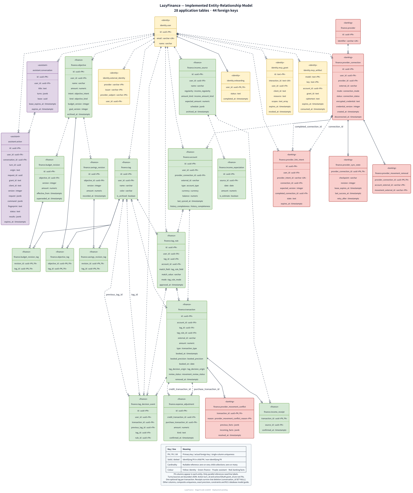
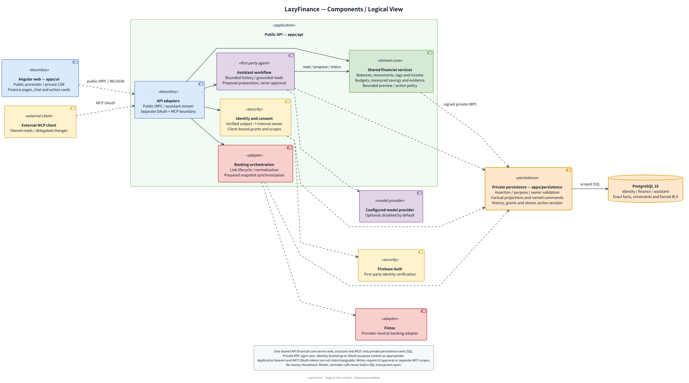
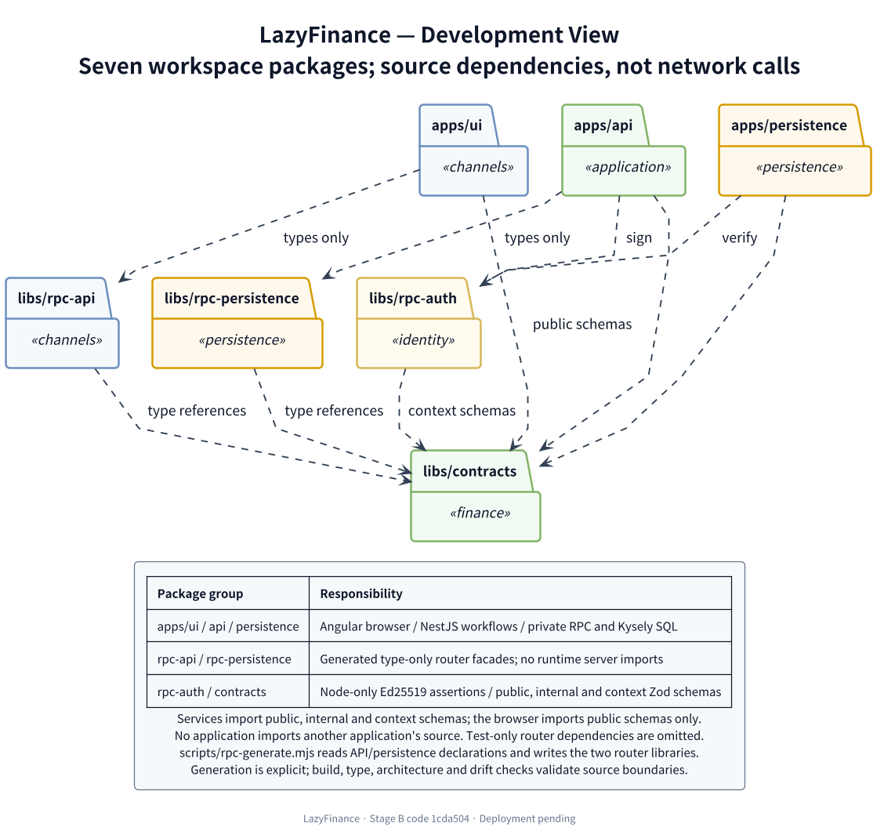
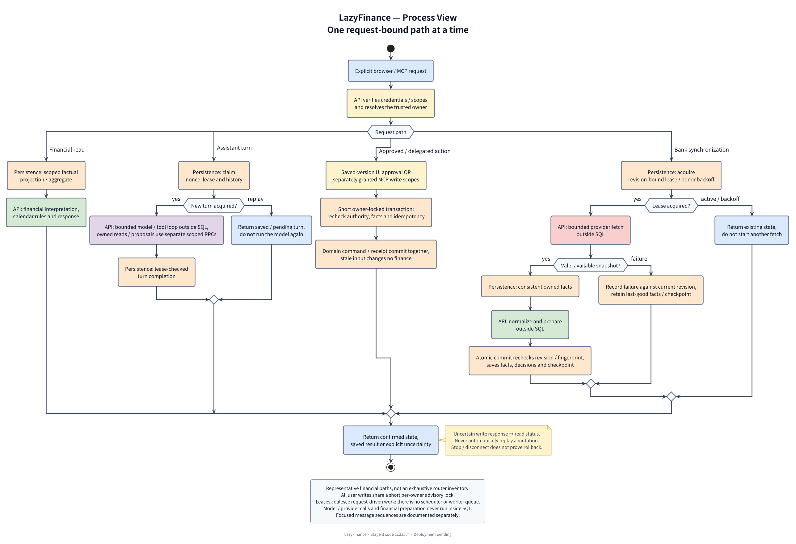
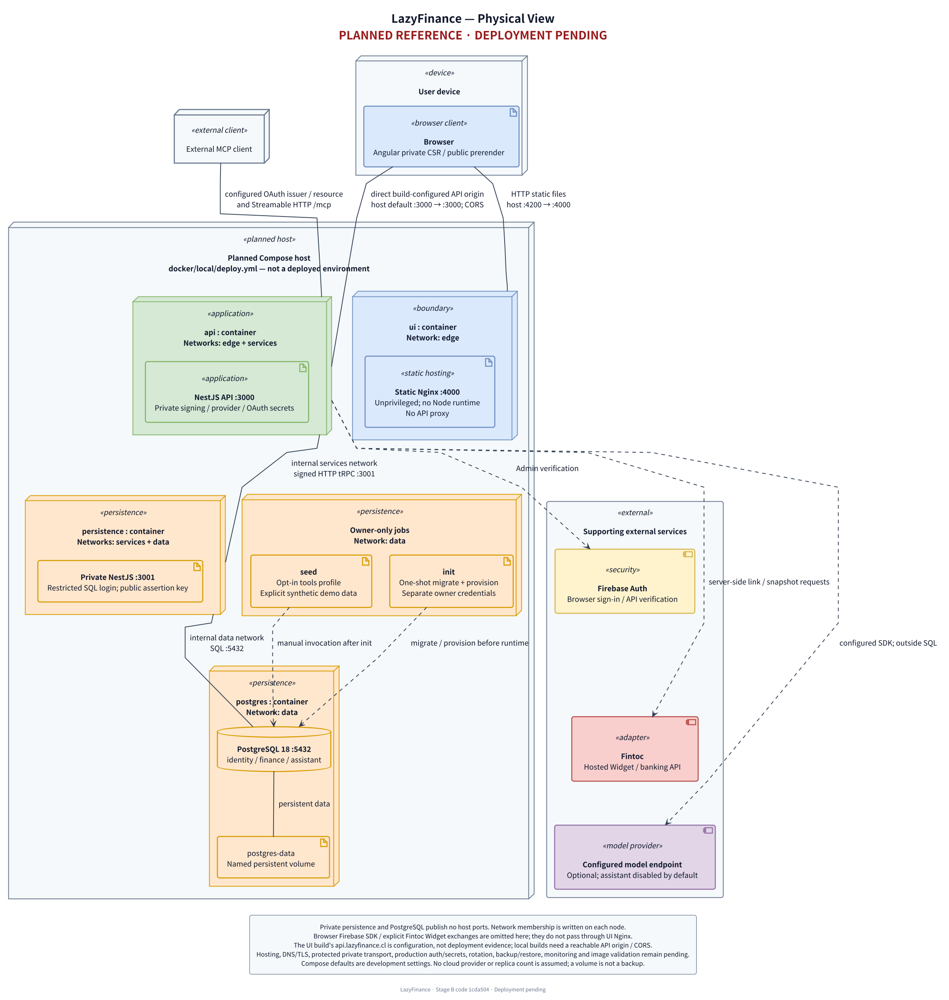
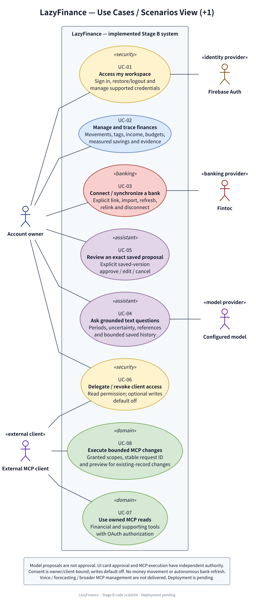
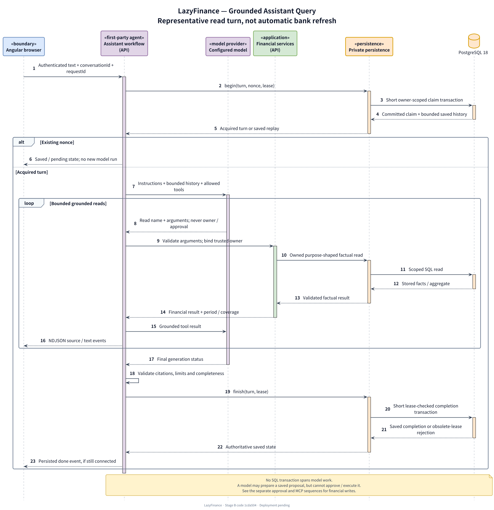
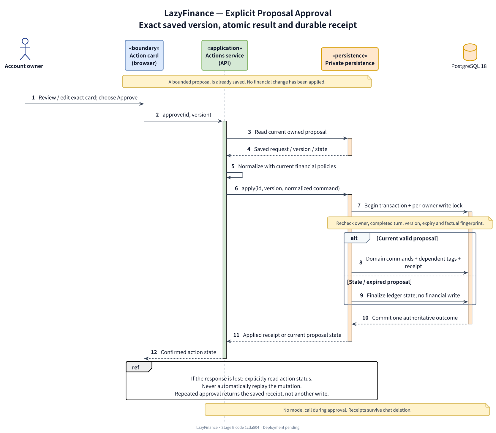
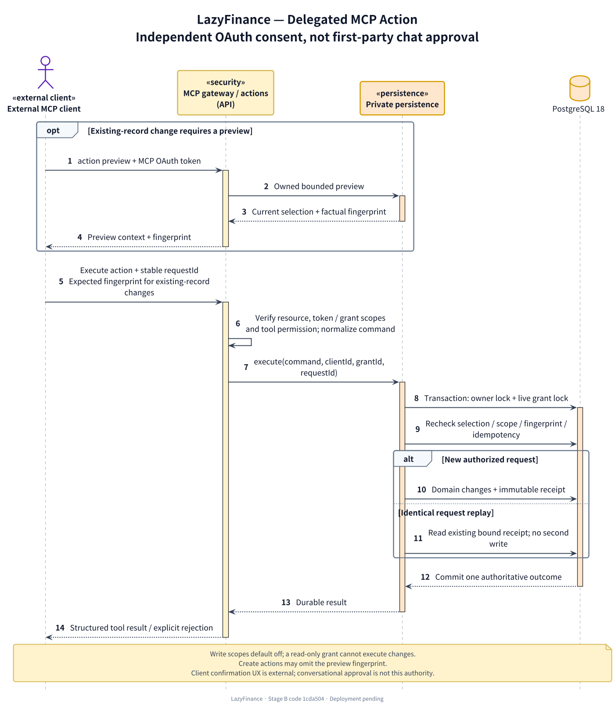
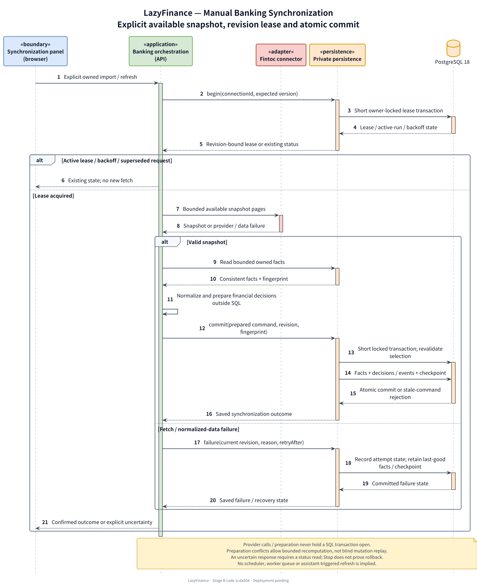

# Implemented ER and 4+1 architecture views

These views describe the **Stage B implementation at `1cda504`**, with its closure
documentation at `14aef36`, reviewed on **2026-11-09**. They are derived from the
checked-in migrations, application modules, shared-library exports and deployment
configuration. The PNGs are rendered documentation, not screenshots of running
infrastructure or evidence that every integration has been validated.

**Deployment is pending.** The physical view shows the existing Compose reference
topology only. Hosting, DNS/TLS ingress and final environment readiness are not
established by these diagrams. No cloud platform, replica count, background worker
or production control is assumed.

| Diagram | View and concern | Editable source | Rendered diagram |
| --- | --- | --- | --- |
| Entity–relationship | Stored entities, primary/foreign keys and actual cardinalities | [er.puml](sources/er.puml) | [Full-size PNG](er.png) |
| Logical / components | Application responsibilities and authority boundaries | [components.puml](sources/components.puml) | [Full-size PNG](components.png) |
| Development | Workspace packages, source dependencies and generated type boundaries | [development.puml](sources/development.puml) | [Full-size PNG](development.png) |
| Process | Activity overview of request paths, leases, locks and atomic outcomes | [process.puml](sources/process.puml) | [Full-size PNG](process.png) |
| Physical | **Planned** deployment nodes, networks, ports and external dependencies | [physical.puml](sources/physical.puml) | [Full-size PNG](physical.png) |
| Scenarios (+1) / use cases | User/client scenarios connecting the other four views | [use-cases.puml](sources/use-cases.puml) | [Full-size PNG](use-cases.png) |
| Assistant query | A grounded text turn through shared financial services | [agent-sequence.puml](sources/agent-sequence.puml) | [Full-size PNG](agent-sequence.png) |
| Proposal approval | Explicit saved-version approval and atomic receipt | [approval-sequence.puml](sources/approval-sequence.puml) | [Full-size PNG](approval-sequence.png) |
| Delegated MCP action | Preview, independently granted writes and idempotency | [mcp-sequence.puml](sources/mcp-sequence.puml) | [Full-size PNG](mcp-sequence.png) |
| Banking synchronization | Explicit snapshot fetch, preparation and atomic commit | [bank-sync-sequence.puml](sources/bank-sync-sequence.puml) | [Full-size PNG](bank-sync-sequence.png) |

The 4+1 views use UML component, package, activity, deployment and use-case
notation; the ER uses Information Engineering crow's feet. Each is an
architectural projection, not a dump of every class or procedure. Follow the
source links below for implementation detail. Open the full-size PNGs to inspect
or reuse them in a report. Editable PlantUML sources and their
[shared style](sources/style.iuml) live in `sources/`. The implementation-backed
component, use-case and assistant sequence replace the earlier conceptual sketches;
there are no parallel conceptual PNGs or duplicate logical/scenario image copies.

## Styling and diagram conventions

The set uses a consistent pastel role palette, bold names, italic stereotypes,
explicit subsystem boundaries and standard UML symbols. Every maintained image
describes implemented responsibilities or the explicitly planned physical topology.
Colour supplements labels; it never establishes authorization or deployment status.

| Role | Fill / border |
| --- | --- |
| Web channels and UI boundaries | Blue `#DAE8FC` / `#6C8EBF` |
| Shared financial/domain services | Green `#D5E8D4` / `#82B366` |
| Identity, consent and delegated access | Yellow `#FFF2CC` / `#D6B656` |
| First-party assistant and model integration | Purple `#E1D5E7` / `#9673A6` |
| Banking adapters and provider facts | Red `#F8CECC` / `#B85450` |
| Private persistence and database artifacts | Orange `#FFE6CC` / `#D79B00` |
| Subsystem/external boundaries | Pale neutral fill with labelled borders |

- **Logical:** UML 2 component symbols and labelled calls/dependencies, not class
  inheritance. The diagram groups related API responsibilities instead of drawing
  every adapter or procedure. All workflows use the shared private-RPC boundary.
- **Development:** folder-shaped UML packages; dashed arrows are source imports,
  with type-only dependencies and signing/verification distinguished. Generation
  inputs/outputs are described in the legend rather than adding crossing arrows.
  None of these are network links.
- **Process:** an activity overview separates alternative request paths and the
  API/persistence/network responsibility for each step. The paths are not one
  long transaction or a set of concurrent background workers.
- **Focused sequences:** numbered messages, dashed returns/lifelines, activation bars and
  `loop`/`alt`/`opt` fragments. Short database activations distinguish SQL scopes
  from model/provider work. Activations do not imply separate worker processes.
- **Physical:** deployment nodes contain runtime artifacts; lines show configured
  communication paths, with networks/ports written explicitly. One-shot jobs and
  external calls are distinguished from the internal service path. The host remains
  **planned**, not an installed environment.
- **Scenarios (+1):** actors outside a system boundary, true use-case ellipses,
  stable `UC-01`–`UC-08` identifiers and solid actor associations without arrowheads.
  Do not invent `include`/`extend` relationships to connect otherwise independent
  workflows; shared policies are explained in notes instead.
- **ER:** qualified SQL entity names, selected typed attributes and explicit
  PK/FK/UK markers; actual nullable cardinalities and identifying/non-identifying
  lines. This is an implemented relational model, not an object class hierarchy.

## Entity–relationship diagram



- **28 tables / 44 foreign keys**, checked against the 29 migration `up` paths.
  The owner-only migration ledger is infrastructure and is not an application
  entity. Titles use qualified SQL `schema.table` names; underscore aliases exist
  only in the source for linking relationships.
- The diagram includes every table, PK column and real FK. Other displayed
  attributes are selected for financial, ownership or lifecycle meaning; this is
  not complete DDL. `text_array` represents PostgreSQL `text[]`; enum types omit
  their SQL schema prefix and numeric precision remains in the model guide.
- Crow's-foot ends show cardinality. A dotted relationship is non-identifying;
  a solid relationship means the FK participates in the child's primary key.
  Nullable parent references use zero-or-one; child collections have minimum zero.
  FK columns are marked inside each entity; only parallel references between the
  same two tables have line labels, avoiding repeated ownership-label clutter.
- A transaction has at most one optional tag. Objective/revision tag selections
  are separate many-to-many relationships; there is no transaction–tag join table.
- Conversation turns/sources are JSON, not invented relational tables.
  `assistant.action.turn_id` is not an FK. Action/OAuth `grant_id` fields are not
  FKs; action receipts survive chat deletion through a nullable conversation FK.
- Valid foreign keys do not replace related-owner RLS. The shared provider catalog
  is runtime-read-only; all 27 sensitive tables force RLS.

Sources: [migrations](../../apps/persistence/src/database/migrations),
[database model and constraints](../technical/database-model.md),
[persistence security](../technical/persistence-security.md).

## Logical view



The UI, first-party assistant and MCP reuse API financial services. Authentication,
external-client authorization, model orchestration and provider normalization have
different responsibilities. Only private persistence owns SQL and named atomic
commands; factual aggregates do not move financial interpretation into the UI.

The first-party model prepares/corrects proposals and reads status, never approves or executes.
Card approval and separately consented MCP writes have distinct authorization
paths. First-party sign-in/consent and MCP OAuth are different credential
boundaries: Firebase/application bearers are not accepted on `/mcp`. Model and
provider calls stay outside SQL.

Sources: [API modules](../../apps/api/src/app.module.ts),
[private modules](../../apps/persistence/src/app.module.ts),
[architecture](../technical/architecture.md),
[assistant/actions](../technical/financial-assistant.md),
[MCP authorization](../technical/mcp-authorization.md).

## Development view



The seven workspace packages are three applications plus contracts, two generated
router libraries and Node-only RPC authentication. Public/internal/context exports
serve different consumers. Router facades export **types only**; generated
placeholder routers are not browser runtime servers. Dashed schema/type-import
and generation dependencies do not represent network calls. Test-only typed client
dependencies are omitted from this application-source map.

There are no cross-application source imports. UI consumers cannot import private
schemas, signing code, SQL or Nest. Source tests, integration fixtures, generated
drift checks and Docker artifacts support the implementation without becoming
additional product runtimes.

Sources: application and library `package.json` files,
[contracts exports](../../libs/contracts/package.json),
[public facade](../../libs/rpc-api/src/index.ts),
[private facade](../../libs/rpc-persistence/src/index.ts),
[RPC workflow](../technical/rpc-contracts.md#changing-a-contract-or-procedure),
[development rules](../technical/development-workflow.md).

## Process view



The activity diagram separates request-bound paths, rather than combining every
message into one oversized sequence. Authentication/protocol detail is condensed
after a trusted owner or MCP grant has been resolved. Ordinary financial reads use
the same scoped private RPC boundary without invoking a model or bank.

1. **Assistant turn:** a short transaction claims nonce/lease/history. Bounded
   model execution stays outside SQL; each owned read/proposal uses a separate
   scoped RPC. A lease-checked transaction confirms the saved turn.
2. **First-party approval:** the exact saved version is revalidated under the
   per-user write lock. Domain changes, dependent tags and receipt commit together.
   Stale/expired input changes no finance. An uncertain response triggers a status
   read; repeated approval returns the saved receipt, not another financial write.
3. **MCP direct execution:** token/tool scopes and the stored grant authorize the
   bounded command independently of chat. Persistence rechecks the live grant,
   client/request binding, current selection and idempotency inside the transaction.
   Existing-record changes require a matching preview fingerprint; the supported
   create actions can be submitted without one.
4. **Bank synchronization:** only the acquired-lease path fetches bounded Fintoc
   pages and prepares decisions. Revalidated commit saves facts, decisions and
   checkpoint atomically. Failure retains last-good data. Active leases/backoff
   return existing state rather than starting another run.

These are request-driven processes. A durable lease is not a job queue or
scheduler. Stop/disconnection prevents obsolete answer adoption; it does not
prove rollback of an already committed command. The view omits repetitive returns,
some policy branches and the separate bank-link Widget exchange.

See the [focused sequences](#focused-message-sequences) for the actual message
boundaries, without making the overview unreadably tall.

Sources: [assistant orchestration](../../apps/api/src/assistant/assistant.service.ts),
[action commands](../../apps/persistence/src/actions/action.repository.ts),
[banking orchestration](../../apps/api/src/banking/ingestion/banking-ingestion.service.ts),
[transaction middleware](../../apps/persistence/src/rpc/rls.middleware.ts).

## Physical view — deployment pending



This view maps the checked-in **local deployment reference**, not an installed
production system. `ui`, `api`, `persistence` and `postgres` are configured service
containers, with separate owner-only initialization and opt-in seed jobs.

- `data` and `services` are internal networks. API has no data-network membership;
  UI has no services/data membership. Database and persistence publish no host
  ports in `deploy.yml`.
- Default mappings are UI host `4200` → container `4000` and API host `3000` →
  container `3000`. They are configuration defaults, not reachable-endpoint claims.
- UI Nginx serves static assets only, with no request-time Angular/Node process or
  API proxy. Browser requests go directly to the build-configured API origin.
  The production build's `https://api.lazyfinance.cl` is **not deployment evidence**;
  an entirely local rehearsal needs an appropriate browser build URL and CORS.
- Owner credentials belong to explicit init/seed jobs. Persistence uses its
  restricted SQL login; the API alone holds private signing/provider/OAuth secrets.
  A named data volume is not a backup/restore procedure.
- Optional providers require configuration. The Compose API defaults to development
  mode/mock authentication and disables the assistant. Production auth, keys and
  supported OAuth/browser origins require deliberate setup.
- Production hosting, DNS/TLS ingress, protected private transport, secrets/rotation,
  monitoring, backup/restore, rate/cost controls and exact-image/environment
  validation remain pending. No AWS/Kubernetes/managed-database architecture is
  implied by the diagram.

Sources: [deploy.yml](../../docker/local/deploy.yml),
[UI Dockerfile](../../apps/ui/Dockerfile), [static Nginx](../../apps/ui/nginx.conf),
[operational manual](../technical/technical-manual.md#compose),
[Stage B carryovers](../planning/stage-b/closure.md#accepted-limitations-and-carryovers).

## Scenarios view (+1)



| Scenario | User journey / supported outcome |
| --- | --- |
| UC-01 — Access workspace | J6: verified identity, owned browser sessions and supported credential methods |
| UC-02 — Manage/trace finance | J1–J5 and J7: meaningful balances, periods, declarations, measured allocations and evidence |
| UC-03 — Connect/synchronize bank | J8: explicit lifecycle and available-snapshot commands, with freshness and first-link tracking context |
| UC-04 — Ask text questions | J9: bounded grounded conversation, uncertainty and trusted financial reference cards |
| UC-05 — Review proposal | J10: explicit saved-version approval/edit/cancel, atomic receipts and uncertain-outcome reconciliation |
| UC-06–UC-08 — Delegate/use MCP | J11: account/client-bound consent/revocation, owned reads and separately scoped bounded direct writes |

These are supported implementation scenarios, not certification that every live
provider/model/client combination passed. Broader MCP management, voice, advanced
analysis and additional providers are not shown as delivered capabilities. See the
[journeys](../product/user-journeys.md) and
[Stage B evidence/limitations](../planning/stage-b/closure.md).

## Focused message sequences

### Grounded assistant query



This representative read turn uses stored facts, bounded history and explicit
sources. It does not introduce voice, direct SQL from the financial core or
assistant-triggered bank refresh. A repeated nonce returns saved state instead of
running the model again. See [assistant orchestration](../../apps/api/src/assistant/assistant.service.ts).

### Explicit proposal approval



The card already references a saved, unapproved proposal. A new model response is
not needed for approval. Stale facts change no finance, and an uncertain response
requires a status read. See [API actions](../../apps/api/src/actions/actions.service.ts)
and the [authoritative ledger](../../apps/persistence/src/actions/action.repository.ts).

### Delegated MCP action



Client consent and write scopes are independent of chat approval. Preview is
required for existing-record changes; create actions may omit its fingerprint.
The transaction binds the live grant, client and request ID. See
[MCP authorization](../technical/mcp-authorization.md) and the
[direct-action contract](../../libs/contracts/src/financial-actions.ts).

### Manual banking synchronization



Only an acquired lease fetches available snapshot pages. Provider calls and
financial preparation occur outside SQL; revision/fingerprint checks protect the
short commit. Failure retains last-good data. See
[banking orchestration](../../apps/api/src/banking/ingestion/banking-ingestion.service.ts).

## Editing and rendering

The `sources/*.puml` files are editable sources. `sources/style.iuml` owns the
palette/typography; `sources/sequence.iuml` owns the common sequence conventions.
The `.png` files in this directory are their
rendered outputs. Keep source and output changes together. The database model
guide embeds this ER PNG rather than maintaining another diagram definition.

Render from the repository root with **PlantUML 1.2026.9**, a supported Java
runtime and local **Graphviz** (`16.1.0` was used for this set). Set `PLANTUML_JAR`
to your local PlantUML JAR. Graphviz's `dot` must be on `PATH`, or selected through
`GRAPHVIZ_DOT`. No hosted diagram server is used:

```sh
for source in docs/diagrams/sources/*.puml; do
  java -Djava.awt.headless=true -DPLANTUML_LIMIT_SIZE=16000 \
    -jar "$PLANTUML_JAR" -failfast2 -tpng -o .. \
    "$source"
done
```

The output path is relative to each source file, placing PNGs directly in
`docs/diagrams/`. Keep downloaded tooling and machine-specific paths outside the
repository. The theme uses Java's logical sans-serif font; installed font
fallbacks may slightly alter metrics between machines. Rendering does not start
the application stack, apply migrations, call a model/bank or deploy it.

When changing the ER, compare table names, PK/FK columns, nullable ends and
identifying relationships against migration `up` definitions. When changing a
view, review its linked source and update the corresponding technical guide.
Review every rendered PNG at full size for clipped text, overlapping labels,
unnecessary crossings, legible type and consistent symbols; a successful render
does not establish readability by itself.
Rendering/syntax checks alone do not prove database behavior, security, provider
quality, deployment readiness or a performance target.
