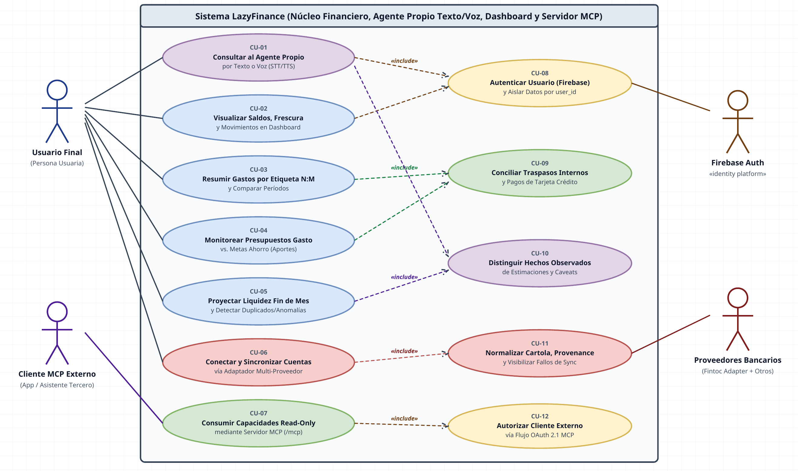
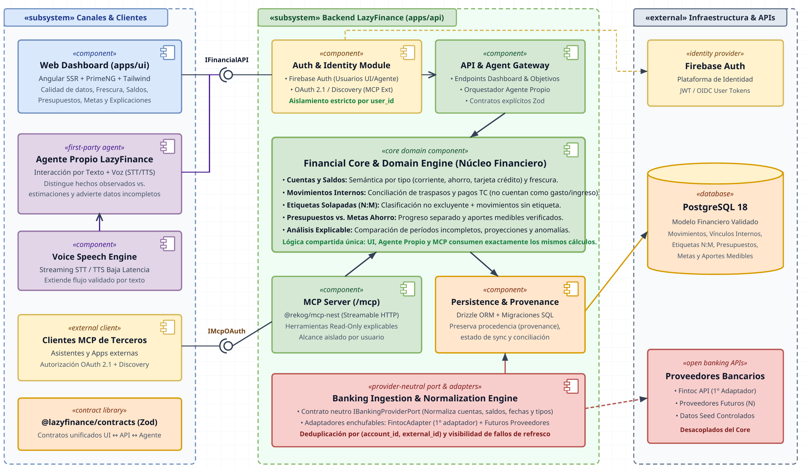
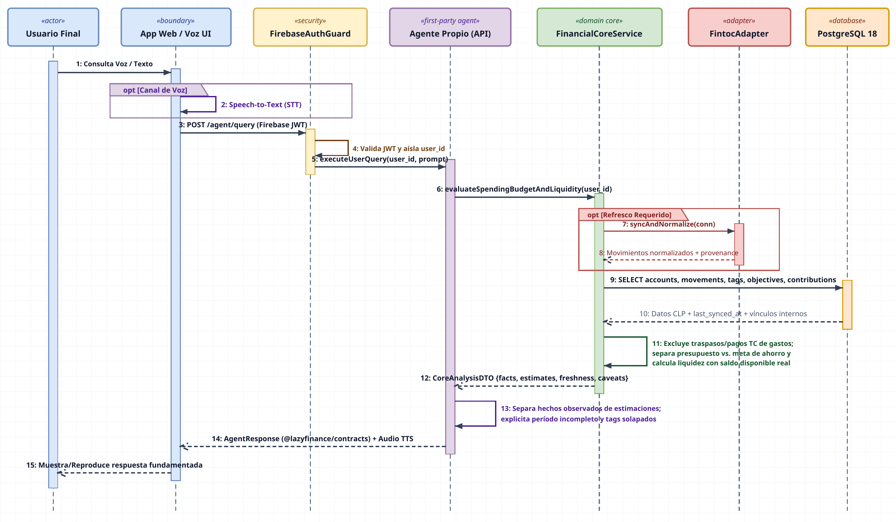

# Conceptual UML diagrams

These selected PNGs are **unchanged visual sketches of possible LazyFinance interactions and structure**, not diagrams of the currently shipped implementation or a verified database model. They can help discuss the product direction described in the [product vision](../product/product-vision.md); the [current architecture](../technical/architecture.md) and [implemented database model/ERD](../technical/database-model.md) describe what actually exists.

| Diagram                                               | What it illustrates                                                                                        |
| ----------------------------------------------------- | ---------------------------------------------------------------------------------------------------------- |
| [Use-case overview](conceptual-use-cases.png)         | Potential user, banking-provider and external-MCP-client interactions.                                     |
| [Component overview](conceptual-components.png)       | Intended separation between interfaces, financial services, identity, ingestion and external integrations. |
| [Agent query sequence](conceptual-agent-sequence.png) | A possible text/voice-agent conversation using financial context and a bank adapter.                       |

**Interpretation limits:** The sketches contain an older **many-to-many transaction-tag** assumption. The current model gives each transaction at most one optional tag; a spending budget can select multiple tags. They also depict a first-party agent, voice, a Fintoc adapter and external-client authorization as parts of a proposed system; those integrations are not established by these images. The class-diagram candidate was not selected as a data-model diagram because its entities and relationships differ from the checked-in schema. Use the separate [source-verified Mermaid ERD](../technical/database-model.md#implemented-relationship-diagram) for the actual 17-table identity/finance model; these historical PNGs remain unchanged.

