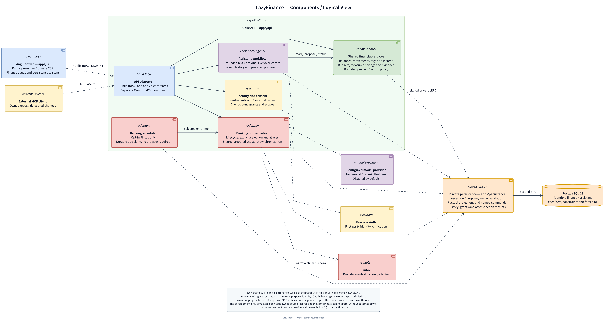
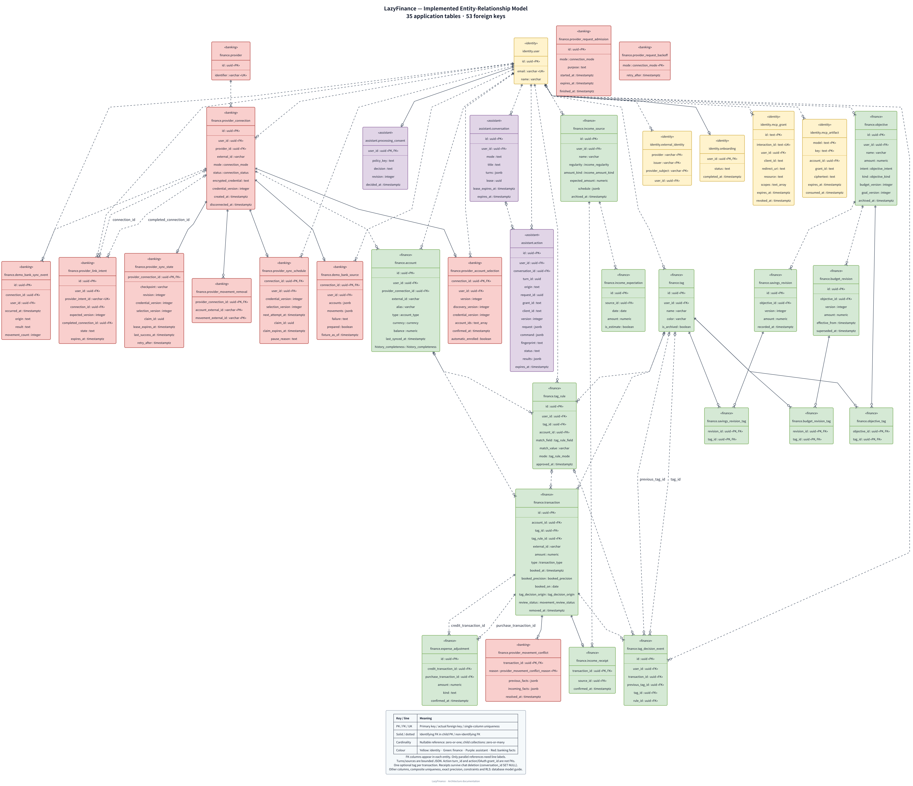
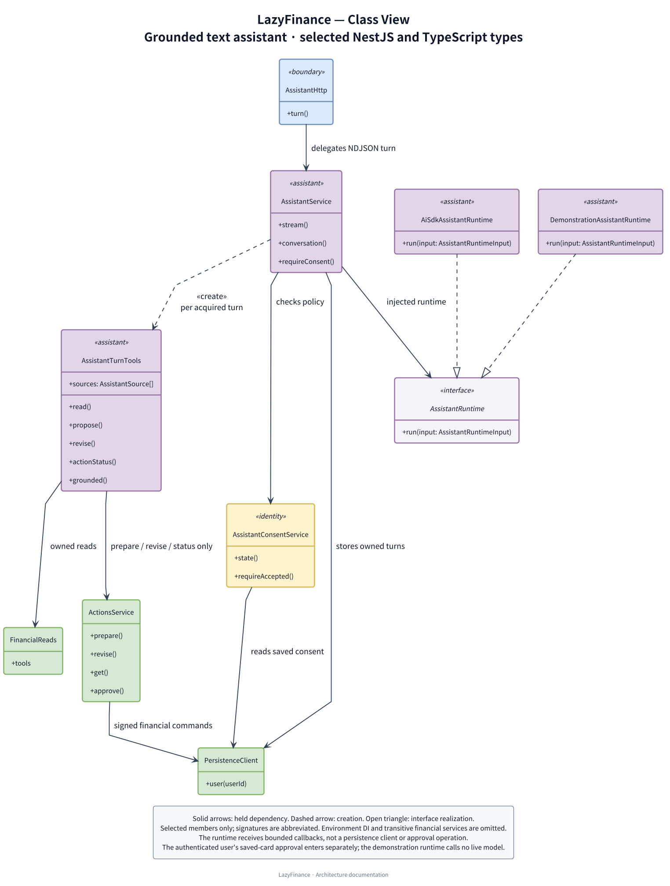
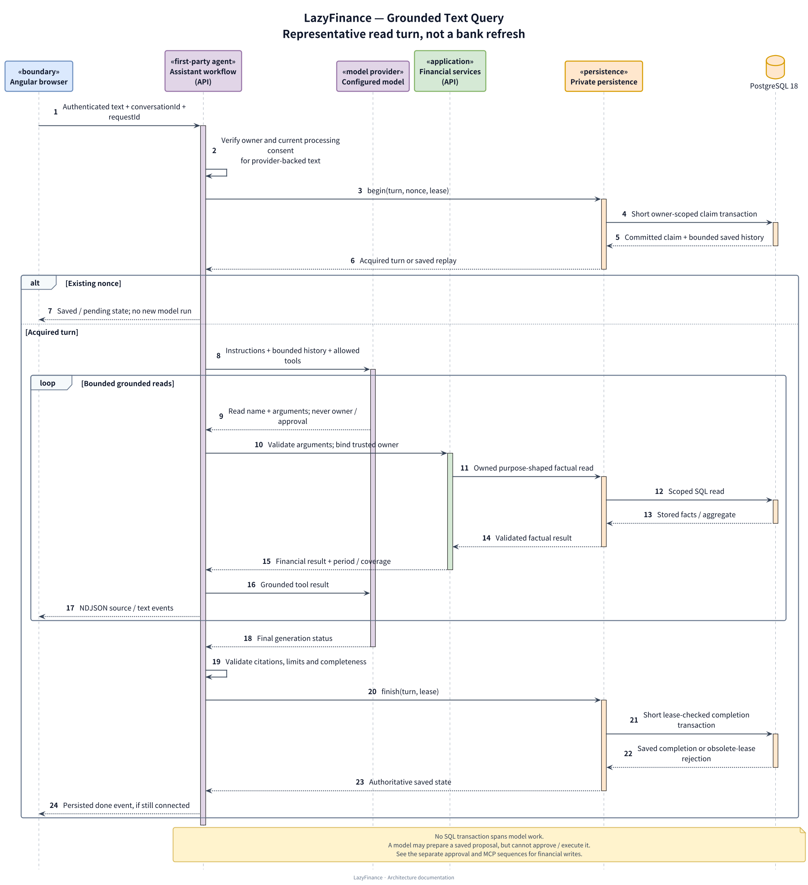
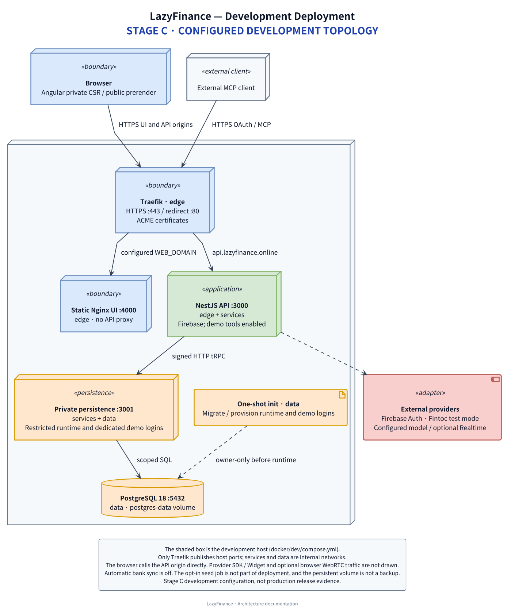

# LazyFinance — Documento de diseño

**Proyecto APT · Fase 3.** Diseño implementado al corte del 24 de noviembre de
2026, sobre [`main` en `815a4bda`](https://github.com/ig-peralta/LazyFinance/commit/815a4bdac447823bf644b81b3d5b6de970d2fe47).
Las vistas reutilizan el [atlas de arquitectura](../../diagrams/README.md). La
propuesta de producción se distingue del despliegue de desarrollo y no está
implementada como un entorno de producción.

## 1. Problema de diseño

El titular debe poder entender una cifra, seguirla hasta sus datos de origen y
decidir si quiere actuar. La misma pregunta sobre un período debe tener el mismo
significado en la web, el asistente y un cliente autorizado. Vincular un banco,
consultar y aprobar un cambio son operaciones diferentes. El diseño limita
quién puede ver o modificar información y conserva el último resultado
confirmado cuando una sincronización falla.

## 2. Arquitectura, componentes y comunicación

| Capa | Responsabilidad y comunicación |
| --- | --- |
| **UI Angular** | Nginx entrega archivos estáticos: HTML público prerenderizado y espacio privado renderizado en el navegador. El navegador usa el origen del API directamente; tRPC transporta lecturas y comandos, y NDJSON entrega eventos del asistente. |
| **API NestJS** | Verifica credenciales, resuelve al titular, aplica reglas financieras y coordina el asistente y la banca. Ofrece OAuth/MCP en un límite de autorización separado. No tiene conexión ni credenciales SQL. |
| **Persistencia NestJS/Kysely** | Recibe tRPC privado con contexto firmado, lo verifica y abre la transacción con el alcance correspondiente. Expone proyecciones y comandos definidos, no SQL genérico. Solo esta aplicación accede a la base de datos en operación normal. |
| **PostgreSQL 18** | Mantiene datos, restricciones, políticas RLS y atomicidad. La cuenta propietaria del esquema se reserva a las tareas explícitas de migración o carga; no se usa en el pool normal. |
| **Integraciones** | Firebase verifica identidad web; los adaptadores llaman a Fintoc o al modelo configurado fuera de la transacción SQL. Si se habilita voz, el navegador mantiene el audio WebRTC con el proveedor y el API conserva la autorización y las herramientas financieras. |

El repositorio contiene tres aplicaciones y bibliotecas de contratos públicos,
internos y de contexto; los clientes usan tipos de routers generados y el
firmado privado queda fuera del navegador. La
[vista de desarrollo](../../diagrams/development.png) muestra esas dependencias
de código, no conexiones de red. Véase el [detalle de arquitectura](../../technical/architecture.md).

## 3. Modelo de datos relacional

Las migraciones hasta `039` definen **35 tablas de aplicación y 53 claves
foráneas**. `identity` vincula identidades verificadas, titulares y permisos;
`finance` registra conexiones, cuentas, movimientos, clasificación, presupuestos,
metas e ingresos; `assistant` conserva conversaciones, consentimiento y
propuestas/comprobantes. El catálogo de proveedores es compartido y de solo
lectura para el runtime; las otras 34 tablas fuerzan RLS con sus respectivos
alcances. Una clave foránea por sí sola no autoriza acceso entre titulares.

Los hechos bancarios y las decisiones del usuario se almacenan por separado.
Un movimiento admite una sola etiqueta opcional; una revisión de presupuesto
puede seleccionar varias. Los saldos reportados no se reconstruyen a partir de
movimientos incompletos. Una importación autorizada aplica cambios y punto de
control en una transacción; un fallo no genera un nuevo saldo confirmado.
El [modelo de datos](../../technical/database-model.md) detalla atributos y
relaciones; el [ERD ampliado](../../diagrams/er.png) muestra cardinalidades.

## 4. Vistas UML

| Vista | Alcance |
| --- | --- |
| [Casos de uso](../../diagrams/use-cases.png) | Titular, cliente externo y proveedores; acceder, gestionar finanzas, sincronizar, consultar y aprobar de manera explícita. |
| [Componentes](../../diagrams/components.png) | Qué capa verifica identidad, aplica reglas, orquesta integraciones y guarda hechos. |
| [Actividad del proceso](../../diagrams/process.png) | Caminos de lectura, conversación, aprobación y sincronización manual/programada. |
| [Clases del asistente](../../diagrams/assistant-classes.png) | Clases e interfaz TypeScript verificables en el código, con dependencias, creación de herramientas por turno y realizaciones de `AssistantRuntime`. No representa tablas. |
| [Secuencia de la consulta principal](../../diagrams/agent-sequence.png) | Orden de mensajes: admitir un turno autorizado, consultar fuentes, emitir eventos y confirmar el estado guardado. |
| [Aprobación](../../diagrams/approval-sequence.png), [MCP](../../diagrams/mcp-sequence.png) y [sincronización bancaria](../../diagrams/bank-sync-sequence.png) | Secuencias complementarias que no deben confundirse con un turno de consulta. |

La vista de clases corresponde porque el caso principal se implementa con clases
que colaboran. `AssistantHttp` delega en `AssistantService`. Este crea
`AssistantTurnTools` por turno adquirido y entrega al runtime callbacks limitados.
`AiSdkAssistantRuntime` y `DemonstrationAssistantRuntime` realizan la misma
interfaz; el segundo funciona sin un modelo externo. Las herramientas consultan
`FinancialReads` y piden a `ActionsService` preparar, corregir o consultar una
propuesta; **no** llaman a `approve()`. Los aspectos transversales de NestJS y
las dependencias transitivas se omiten para conservar la legibilidad.

En la consulta principal, los permisos y el consentimiento se comprueban antes
de enviar texto al proveedor. Cada lectura usa el titular verificado y el
modelo no recibe un cliente SQL. Se confirma el turno por separado; si ya se
conoce la solicitud, se devuelve el estado guardado sin repetir la generación.
La [secuencia de aprobación](../../diagrams/approval-sequence.png) empieza en la
tarjeta del usuario, no en las instrucciones al modelo.

## 5. Decisiones técnicas y consecuencias

| Decisión | Por qué se eligió y qué no resuelve |
| --- | --- |
| Validar el núcleo antes de integrar Fintoc | Los ejemplos reproducibles detectaron diferencias sobre transferencias e ingresos antes de que un proveedor condicionara el modelo. Los datos sintéticos no prueban cobertura o frescura bancaria real. [Cierre A](../../planning/stage-a/closure.md). |
| API para significado financiero; persistencia privada para hechos y atomicidad | Centraliza períodos, montos e interpretación y permite leer agregados acotados en SQL sin reproducir reglas en cada UI. Agrega un salto RPC y requiere contratos versionados y aislamiento de red; RLS no sustituye esos controles. [Evolución de la plataforma](../../planning/stage-b/platform-evolution.md). |
| Prerender público y páginas privadas en el navegador | Desacopla hosting y sesión verificada, sin estado financiero incrustado en HTML. El navegador debe restaurar su credencial y las vistas gestionan carga y cancelación. [Ciclo de vida UI](../../technical/ui-data-lifecycle.md). |
| Selección explícita y concesiones de sincronización | Conserva historial al deseleccionar y evita que una cuenta nueva se incorpore sola. Las versiones y las esperas limitan trabajo duplicado, sin forzar a Fintoc a refrescar el dato ni garantizar su disponibilidad. [Política de sincronización](../../planning/stage-c/banking-sync-policy.md). |
| Consentimiento y confirmación separados del modelo | Permite respuestas y propuestas fundamentadas sin otorgar capacidad de ejecución al modelo. Una tarjeta aprobada y una escritura MCP con permiso propio son canales distintos; ambos reciben comprobantes. La voz requiere habilitación y verificación con el proveedor. [Asistente](../../technical/financial-assistant.md) · [MCP](../../technical/mcp-authorization.md). |

## 6. Docker, despliegue y calidad

- **Local:** [Compose local](../../../docker/local/deploy.yml) y los Dockerfiles
  de [UI](../../../apps/ui/Dockerfile), [API](../../../apps/api/Dockerfile) y
  [persistencia](../../../apps/persistence/Dockerfile) separan procesos y
  credenciales. El [manual](../../technical/technical-manual.md#compose) explica
  los pasos y los [ejemplos de entorno](../../../.env.example) no contienen
  credenciales reales de despliegue.
- **Desarrollo:** [Compose de desarrollo](../../../docker/dev/compose.yml) usa
  Traefik para HTTP/HTTPS (`80`/`443`). UI y API se alcanzan por el proxy; ni
  persistencia ni PostgreSQL publican sus puertos. `init` migra y provisiona;
  el despliegue no ejecuta la carga de demostración. Véase el
  [manual de operación](../../technical/technical-manual.md#development-deployment).
- **Producción propuesta:** [diagrama](../../diagrams/production.png) y
  [documento](../../technical/production-deployment.md) describen ingreso HTTPS,
  enlaces privados TLS y respaldos/recuperación, sin implicar un servicio en
  ejecución. La capacidad, disponibilidad, operación y recuperación necesitan
  validación en el entorno elegido; no se declara un SLA.

Los [requisitos no funcionales](../../product/non-functional-requirements.md)
definen aislamiento, integridad, degradación y portabilidad, entre otros.
El [anexo de pruebas](pruebas/README.md) enlaza la evidencia y conserva los
límites del rendimiento y de la auditoría de seguridad.
