# Implemented database model

This reference describes the checked-in Kysely migrations, not a conceptual
product model. PostgreSQL 18 holds **24 application tables** in fixed `identity`
and `finance` schemas. Twenty-three sensitive tables force user/identity RLS;
`finance.provider` is the shared read-only catalog exception. There is no tenancy,
membership or account-sharing model. See [security and RLS](persistence-security.md)
for policy/grant details.

The source of truth is
[`database/migrations`](../../apps/persistence/src/database/migrations).
Runtime types live in schema-root `identity.tables.ts` / `finance.tables.ts` maps
and table-local `*.tables.ts` files under
[`identity`](../../apps/persistence/src/identity) and
[`finance`](../../apps/persistence/src/finance). Migrations deliberately do not
import those evolving runtime interfaces.

## Tables, keys and ownership

All unqualified table names in the finance section below belong to `finance`.
`id` means a UUID primary key unless a different primary key is stated.

| Table | Key / important relationship | Ownership and meaning |
| --- | --- | --- |
| `identity.user` | `id`; unique email, including a case-insensitive unique index | Stable financial owner; normal runtime self-read only |
| `identity.external_identity` | PK `(provider, issuer, provider_subject)`; unique `(user_id, provider, issuer)` | External subject → user; bootstrap-only access, no stored bearer token |
| `identity.onboarding` | PK `user_id` → user | Optional-guide skip/completion; self-owned read/insert and status/timestamp update, no runtime delete |
| `provider` | `id`; unique `identifier` | Shared catalog; runtime SELECT only |
| `provider_connection` | `id` → provider; `user_id`; unique provider/mode/external Link ID | Owned access status, API-encrypted credential/version, institution/holder and terminal disconnect/remote-cleanup state; legacy fixture fields remain nullable |
| `provider_link_intent` | `id`; unique provider intent ID; optional original/completed connection FKs | Owner-bound, expiring callback claims with hashed exchange token, version-pinned relink and durable completion |
| `account` | `id`; unique `(provider_connection_id, external_id)`; `user_id` | Owned account and owned connection must agree; independent nullable source balance |
| `transaction` | `id`; unique non-null `(account_id, external_id)` | Ownership through account; provider fact plus preserved user interpretation |
| `tag` | `id`; unique `(user_id, name)` | User-owned catalog with archive flag |
| `tag_rule` | `id` → owned tag and optional owned account | User-owned exact-match suggestion or approved automatic rule |
| `tag_decision_event` | `id` → movement, optional previous/new tags and rule; `user_id` | Runtime append-only audit history, with every referenced owner checked |
| `objective` | `id`; `user_id` | Stable spending/saving declaration identity; separate budget/goal write versions and archival cutoff |
| `objective_tag` | PK `(objective_id, tag_id)` | Both ends must be owned; multiple tags may describe one budget |
| `budget_revision` | `id` → spending objective; unique `(objective_id, version)` and live effective boundary | Immutable configuration payload; runtime may update only supersession metadata |
| `budget_revision_tag` | PK `(revision_id, tag_id)` | Append-only revision selection; both revision and tag must be owned |
| `savings_revision` | `id` → savings objective; unique `(objective_id, version)` | Append-only configuration snapshots; separate goal write version and archival cutoff |
| `savings_revision_tag` | PK `(revision_id, tag_id)` | Append-only selected tags; both revision and tag owners checked |
| `income_source` | `id`; `user_id` | Regularity, amount behavior, schedule and effective dates |
| `income_expectation` | `id` → source | Source-owned dated expectation for irregular income |
| `income_receipt` | PK `transaction_id`; `source_id` | At most one confirmed source per movement; both ends owned |
| `expense_adjustment` | `id`; unique `(credit_transaction_id, purchase_transaction_id)` | Both movements owned; explicit partial refund/reimbursement with confirmed amount/booking snapshots |
| `provider_sync_state` | PK `provider_connection_id` | Connection-owned checkpoint, revision, success/failure and review metadata |
| `provider_movement_removal` | PK `(provider_connection_id, account_external_id, movement_external_id)` | Connection-owned tombstone, even before the account/movement exists locally |
| `provider_movement_conflict` | PK `(transaction_id, reason)` | Movement-owned old/incoming factual snapshots and review resolution time |

Indexes support direct user lookups, parent ownership checks, account booking
periods, active rules and source/date queries. The keys and RLS checks are
complementary: a valid FK can still point at another user's row unless the write
policy independently rejects it.

## Implemented relationship diagram

The Mermaid ERD uses `identity_` / `finance_` entity prefixes for SQL schema names.
It shows every application-table FK, optional references and selected key columns;
it omits other columns, indexes, check constraints and RLS expressions. It is a
source-verified reference, not generated DDL or an ownership-policy diagram.

```mermaid
erDiagram
    identity_user ||--o{ identity_external_identity : maps
    identity_user ||--o| identity_onboarding : records
    identity_user ||--o{ finance_provider_connection : owns
    identity_user ||--o{ finance_provider_link_intent : initiates
    identity_user ||--o{ finance_account : owns
    identity_user ||--o{ finance_tag : owns
    identity_user ||--o{ finance_tag_rule : owns
    identity_user ||--o{ finance_tag_decision_event : owns
    identity_user ||--o{ finance_objective : owns
    identity_user ||--o{ finance_income_source : owns

    finance_provider ||--o{ finance_provider_connection : identifies
    finance_provider_connection o|--o{ finance_provider_link_intent : reconnects
    finance_provider_connection o|--o{ finance_provider_link_intent : completes
    finance_provider_connection ||--o{ finance_account : contains
    finance_provider_connection ||--o| finance_provider_sync_state : tracks
    finance_provider_connection ||--o{ finance_provider_movement_removal : retains
    finance_account ||--o{ finance_transaction : contains
    finance_account o|--o{ finance_tag_rule : scopes
    finance_tag ||--o{ finance_tag_rule : selects
    finance_tag o|--o{ finance_transaction : classifies
    finance_tag_rule o|--o{ finance_transaction : explains

    finance_transaction ||--o{ finance_tag_decision_event : records
    finance_tag o|--o{ finance_tag_decision_event : previous_tag
    finance_tag o|--o{ finance_tag_decision_event : new_tag
    finance_tag_rule o|--o{ finance_tag_decision_event : explains
    finance_objective ||--o{ finance_objective_tag : selects
    finance_tag ||--o{ finance_objective_tag : groups
    finance_objective ||--o{ finance_budget_revision : retains
    finance_budget_revision ||--o{ finance_budget_revision_tag : selects
    finance_tag ||--o{ finance_budget_revision_tag : groups
    finance_objective ||--o{ finance_savings_revision : retains
    finance_savings_revision ||--o{ finance_savings_revision_tag : selects
    finance_tag ||--o{ finance_savings_revision_tag : groups
    finance_income_source ||--o{ finance_income_expectation : plans
    finance_income_source ||--o{ finance_income_receipt : receives
    finance_transaction ||--o| finance_income_receipt : confirms
    finance_transaction ||--o{ finance_expense_adjustment : credits
    finance_transaction ||--o{ finance_expense_adjustment : original_purchase
    finance_transaction ||--o{ finance_provider_movement_conflict : flags

    identity_user {
        uuid id PK
        string email UK
    }
    identity_external_identity {
        string provider PK
        string issuer PK
        string provider_subject PK
        uuid user_id FK
    }
    identity_onboarding {
        uuid user_id PK, FK
        string status
        timestamptz completed_at
    }
    finance_provider {
        uuid id PK
        string identifier UK
    }
    finance_provider_connection {
        uuid id PK
        uuid user_id FK
        uuid provider_id FK
    }
    finance_provider_link_intent {
        uuid id PK
        uuid user_id FK
        string provider_intent_id UK
        uuid connection_id FK
        uuid completed_connection_id FK
        string state
    }
    finance_account {
        uuid id PK
        uuid user_id FK
        uuid provider_connection_id FK
        string external_id
    }
    finance_transaction {
        uuid id PK
        uuid account_id FK
        uuid tag_id FK
        uuid tag_rule_id FK
        string external_id
    }
    finance_tag {
        uuid id PK
        uuid user_id FK
    }
    finance_tag_rule {
        uuid id PK
        uuid user_id FK
        uuid tag_id FK
        uuid account_id FK
    }
    finance_tag_decision_event {
        uuid id PK
        uuid user_id FK
        uuid transaction_id FK
        uuid previous_tag_id FK
        uuid tag_id FK
        uuid rule_id FK
    }
    finance_objective {
        uuid id PK
        uuid user_id FK
    }
    finance_objective_tag {
        uuid objective_id PK, FK
        uuid tag_id PK, FK
    }
    finance_budget_revision {
        uuid id PK
        uuid objective_id FK
        int version
        timestamptz effective_from
    }
    finance_budget_revision_tag {
        uuid revision_id PK, FK
        uuid tag_id PK, FK
    }
    finance_income_source {
        uuid id PK
        uuid user_id FK
    }
    finance_savings_revision {
        uuid id PK
        uuid objective_id FK
        int version
    }
    finance_savings_revision_tag {
        uuid revision_id PK, FK
        uuid tag_id PK, FK
    }
    finance_income_expectation {
        uuid id PK
        uuid source_id FK
    }
    finance_income_receipt {
        uuid transaction_id PK, FK
        uuid source_id FK
    }
    finance_expense_adjustment {
        uuid id PK
        uuid credit_transaction_id FK
        uuid purchase_transaction_id FK
        numeric amount
        string kind
    }
    finance_provider_sync_state {
        uuid provider_connection_id PK, FK
    }
    finance_provider_movement_removal {
        uuid provider_connection_id PK, FK
        string account_external_id PK
        string movement_external_id PK
    }
    finance_provider_movement_conflict {
        uuid transaction_id PK, FK
        string reason PK
    }
```

There is **no transaction-tag join table**: each transaction has at most one tag.
The many-to-many relationship is objective-to-tag. A receipt references a source,
not a generated payday or expectation. Tombstone external IDs are intentionally
not local account/movement FKs. Provider relation IDs in transactions are source
evidence, not guaranteed local relational links.

## Financial representation and constraints

- Onboarding has no row until an explicit skip/completion. Stored states are
  `skipped` (null `completed_at`) or `completed` (non-null `completed_at`). The
  named upsert preserves terminal completion and its first timestamp, including
  concurrent first writes. No reset/delete RPC exists; financial setup never
  controls this non-financial preference.
- Monetary columns use `numeric(15,2)` and cross RPC as decimal strings. CLP is the
  implemented currency. Transaction amounts are nonzero, with negative debits and
  positive credits enforced together. The balance is nullable and independent of
  movement history: missing history does not establish zero cash or zero debt.
- Checking/savings balances represent signed cash; a card balance follows the
  negative-liability convention, not remaining available credit. Internal transfers
  and card payments still move account balances without becoming earned income or
  purchase spending.
- `date` values stay strings in the pg parser. `timestamptz` values become ISO
  strings at the RPC boundary. A date-only provider booking retains `booked_on`
  and `calendar_day` precision while `booked_at` uses Santiago local noon; an
  actual instant has `instant` precision and no invented calendar-day field.
- History coverage requires ordered date bounds; `complete` requires both bounds
  and `unknown` has neither. Provider observation time and source balance time
  remain separate freshness facts.
- Tag provenance is constrained: `unreviewed` has no tag/rule; `manual` can have
  a tag or intentional null but no rule; `rule` requires both tag and rule.
  Automatic rule mode requires an approval time. Active-rule uniqueness includes
  owner, target tag, direction, normalized field/value and optional account scope.
- Income sources keep regularity and fixed/variable amount behavior independent.
  Fixed amounts and dated expectations are positive. Regular declarations require
  a schedule, irregular declarations do not carry one, and date ranges are ordered.
- Objective checks distinguish amount-only declarations, recurring time-based
  periods and bounded one-off periods. A stored saving intent does not by itself
  implement savings-progress policy.
- Spending revisions retain definition-specific tag membership. Initial adoption
  preserves existing IDs, actual timestamp bounds and the known selection without
  inventing earlier revisions. Superseded pending definitions remain auditable.
  Archival truncates tracking without prorating the limit or freezing transactions;
  historical tag metadata remains readable. Budget timestamp projections preserve
  SQL microseconds.
- Savings revisions retain immutable configuration/tag selections. `goal_version`
  checks writes independently of budget versions; edits restate the current
  allocation view immediately, while archival prevents edits and clips counting
  at the retained server cutoff. Configuration never creates a bank movement or
  an opening allocation. History/detail and measured reads preserve exact bounds.
- Expense adjustments store a positive allocated amount and both confirmed signed
  movement amounts and exact booking instants. Per-row checks enforce distinct
  movements, supported kind, capacity against those snapshots and chronological
  order. The authoritative command checks current eligibility, both aggregate
  capacities and income exclusivity under the common user write lock. Changed
  amounts/instants, removals or incompatible eligibility suspend application without
  deleting the decision. Allocations follow the purchase period/tag, not the credit
  tag/date; later recoveries can correct archived budget purchases without admitting
  purchases booked at or after archival. See [recovery semantics](rpc-contracts.md#expense-recovery-semantics).

SQL checks protect representation and relationships; they do not replace API
calendar calculations or authoritative command checks. For example, receipt
confirmation also locks and validates a clear, booked, nonremoved, explicitly
non-internal credit. See the [public/private procedure reference](rpc-contracts.md),
[tag decisions/rules](../../apps/api/src/transactions/tagging/README.md) and the
[banking boundary](../../apps/api/src/banking/README.md).

## Provider facts, decisions and review

Provider upserts retain local IDs and update source-owned facts. Aliases, manual
tag/no-tag choices, user internal-status overrides, confirmed receipt links and
expense-adjustment allocations are separate user interpretations. Incompatible
provider corrections preserve the bank fact and the user's interpretation, record
a movement conflict where applicable and mark `needs_review`;
removed/unresolved movements cannot silently enter confirmed totals.

Removal tombstones are connection/account/movement scoped, idempotent and can
precede first import. A replay must not resurrect a removed movement. Sync state
advances the checkpoint only with an atomic successful commit, including durable
conflicts/events; failure recording retains last-good facts. Neither the existence
of review tables nor a private review query means a user-facing conflict-resolution
workflow has been shipped.

## Migration and seed lifecycle

Twenty-five migrations are globally ordered across `migrations/identity` and
`migrations/finance`: schema/bootstrap foundations plus the table migrations.
Kysely's PostgreSQL migrator owns locking and transactional DDL/ledger updates.
Each new sensitive table brings its constraints, indexes, grants and RLS together;
do not create an unprotected intermediate migration. The owner-only Kysely ledger
is infrastructure, not an application table or an RPC feature.

Use a **fresh empty database**. There is no Drizzle journal adoption, old-data
import, automatic reset or legacy relocation path. Already applied migrations
must not be edited to upgrade a live database; add ordered migrations for future
changes and validate them on a disposable target. Identity foundation `down`
paths intentionally refuse destructive rollback. Database roles are cluster-wide,
so a fresh database does not eliminate unsafe pre-existing role collisions.

Seeding is explicit owner-only demo tooling, never startup or migration work.
Stable fixture IDs allow repeatable updates and preserve existing transaction
tag decisions; it also rewrites declared demo fixtures and recomputes demo
balances, so it is **not** a generic import or a safe operation on real user data.
The seeded `fintoc` catalog identifier is not evidence of a working Fintoc adapter.
Follow the [persistence setup](../../apps/persistence/README.md) and
[test-database precautions](development-workflow.md#verification-tiers).
