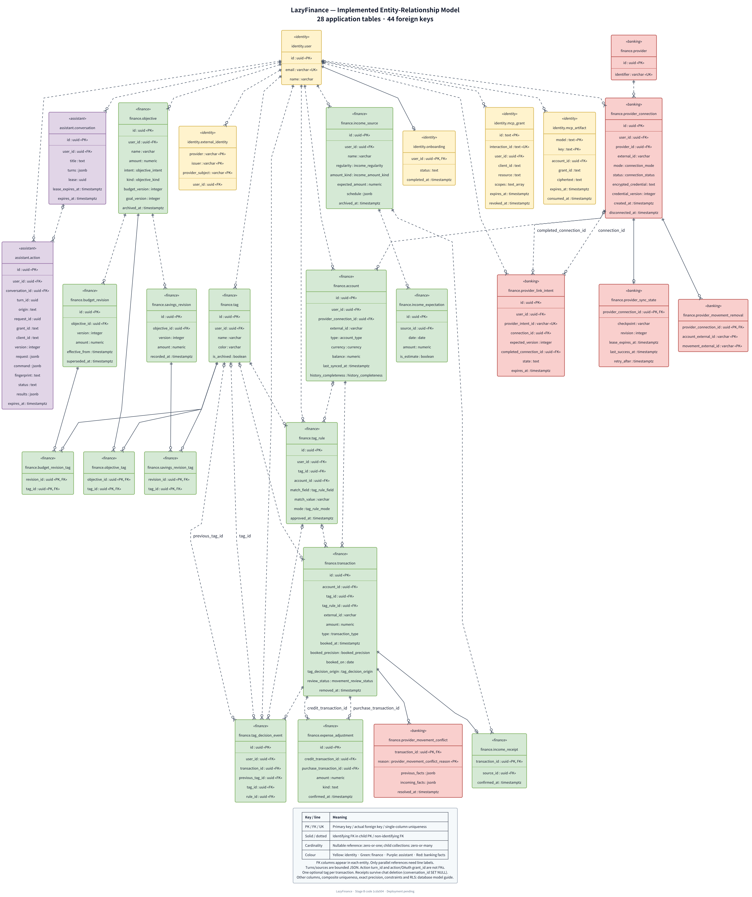

# Implemented database model

This reference describes the checked-in Kysely migrations, not a conceptual
product model. PostgreSQL 18 holds **32 application tables** in fixed `identity`,
`finance` and `assistant` schemas. Thirty-one sensitive tables force scoped RLS;
`finance.provider` is the shared read-only catalog exception. There is no tenancy,
membership or account-sharing model. See [security and RLS](persistence-security.md)
for policy/grant details.

The source of truth is
[`database/migrations`](../../apps/persistence/src/database/migrations).
Runtime types live in schema-root `identity.tables.ts` / `finance.tables.ts` / `assistant.tables.ts` maps
and table-local `*.tables.ts` files under
[`identity`](../../apps/persistence/src/identity) and
[`finance`](../../apps/persistence/src/finance) and
[`assistant`](../../apps/persistence/src/assistant) / [`actions`](../../apps/persistence/src/actions). Migrations deliberately do not
import those evolving runtime interfaces.

## Tables, keys and ownership

All unqualified table names in the finance section below belong to `finance`.
`id` means a UUID primary key unless a different primary key is stated.

| Table | Key / important relationship | Ownership and meaning |
| --- | --- | --- |
| `identity.user` | `id`; unique email, including a case-insensitive unique index | Stable financial owner; normal runtime self-read only |
| `identity.external_identity` | PK `(provider, issuer, provider_subject)`; unique `(user_id, provider, issuer)` | External subject → user; bootstrap-only access, no stored bearer token |
| `identity.onboarding` | PK `user_id` → user | Optional-guide skip/completion; self-owned read/insert and status/timestamp update, no runtime delete |
| `identity.mcp_grant` | Opaque text `id`; unique `interaction_id`; `user_id` → user | Immutable owner/client/resource/scopes/maximum-30-day expiry; self-owned listing and monotonic revocation |
| `identity.mcp_artifact` | PK `(model, key)` with SHA-256 key; optional `account_id` → user | Allowlisted OAuth provider state encrypted by API; expiry/consumption/UID/grant indexes, dedicated-purpose writes |
| `assistant.conversation` | `id`; `user_id` → user; owner/update-time index | Server-owned bounded turns and sources, generation lease and fixed maximum-30-day availability; no financial facts or credentials |
| `assistant.action` | `id`; `user_id` → user; nullable `conversation_id` → conversation; unique `(user_id, origin, request_id)` | Versioned proposals and immutable finalized receipts; client/grant-bound direct execution; chat deletion only nulls its reference |
| `provider` | `id`; unique `identifier` | Shared catalog; runtime SELECT only |
| `provider_connection` | `id` → provider; `user_id`; unique provider/mode/external Link ID | Owned access status, API-encrypted credential/version, institution/holder and terminal disconnect/remote-cleanup state; legacy fixture fields remain nullable |
| `provider_link_intent` | `id`; unique provider intent ID; optional original/completed connection FKs | Owner-bound, expiring callback claims with hashed exchange token, version-pinned relink and durable completion |
| `provider_account_selection` | PK `connection_id`; immutable `user_id` → user | Minimal bounded discovery, credential/discovery/selection versions, selected IDs, consent and connection read backoff; no balances or movements |
| `provider_sync_schedule` | PK `connection_id`; immutable `user_id` → user | Operational eligibility, next due time, failure streak, claim/run references and bounded daily attempts; scheduler can update claim fields only |
| `provider_request_admission` | Caller-generated UUID; mode/purpose and time indexes | Durable deployment-wide rate/concurrency/read-volume admission; dedicated banking-transport context only |
| `provider_request_backoff` | PK `mode` (`test`/`live`) | Greatest retained provider waiting period shared by all transport reads/lifecycle requests; banking-transport context only, no runtime delete |
| `account` | `id`; unique `(provider_connection_id, external_id)`; `user_id` | Owned account and owned connection must agree; independent nullable source balance |
| `transaction` | `id`; unique non-null `(account_id, external_id)` | Ownership through account; provider fact plus preserved user interpretation |
| `tag` | `id`; unique `(user_id, name)` | User-owned catalog with archive flag |
| `tag_rule` | `id` → owned tag and optional owned account | User-owned exact-match suggestion or approved automatic rule |
| `tag_decision_event` | `id` → movement, optional previous/new tags and rule; `user_id` | Runtime append-only audit history, with every referenced owner checked |
| `objective` | `id`; `user_id` | Stable spending/saving declaration identity; separate budget/goal write versions and archival cutoff |
| `objective_tag` | PK `(objective_id, tag_id)` | Both ends must be owned; multiple tags may describe one budget |
| `budget_revision` | `id` → spending objective; unique `(objective_id, version)` and live effective boundary | Immutable configuration payload; runtime may update only supersession metadata |
| `budget_revision_tag` | PK `(revision_id, tag_id)` | Append-only revision selection; both revision and tag must be owned |
| `savings_revision` | `id` → savings objective; unique `(objective_id, version)` | Append-only configuration snapshots; separate goal write version and archival cutoff |
| `savings_revision_tag` | PK `(revision_id, tag_id)` | Append-only selected tags; both revision and tag owners checked |
| `income_source` | `id`; `user_id` | Regularity, amount behavior, schedule and effective dates |
| `income_expectation` | `id` → source | Source-owned dated expectation for irregular income |
| `income_receipt` | PK `transaction_id`; `source_id` | At most one confirmed source per movement; both ends owned |
| `expense_adjustment` | `id`; unique `(credit_transaction_id, purchase_transaction_id)` | Both movements owned; explicit partial refund/reimbursement with confirmed amount/booking snapshots |
| `provider_sync_state` | PK `provider_connection_id` | Connection-owned checkpoint, revision, success/failure and review metadata |
| `provider_movement_removal` | PK `(provider_connection_id, account_external_id, movement_external_id)` | Connection-owned tombstone, even before the account/movement exists locally |
| `provider_movement_conflict` | PK `(transaction_id, reason)` | Movement-owned old/incoming factual snapshots and review resolution time |

Indexes support direct user lookups, parent ownership checks, account booking
periods, active rules and source/date queries. The keys and RLS checks are
complementary: a valid FK can still point at another user's row unless the write
policy independently rejects it.

## Implemented relationship diagram

The [editable PlantUML source](../diagrams/sources/er.puml) and
[full-size rendered PNG](../diagrams/er.png) are part of the
[implemented ER and 4+1 atlas](../diagrams/README.md). They show the earlier
**28-table, 44-foreign-key baseline**, with PK/FK markers, nullable ends,
identifying/non-identifying relationships and selected domain attributes.
Entity titles use qualified SQL `schema.table` names.

The four banking operational tables added by migration `202611100030` are listed
above but not drawn in that baseline image. Selection and schedules each reference
the owned connection and user, bringing the current schema to 32 tables and 48
foreign keys. The transport tables contain no financial-owner references.

The diagram omits other columns, indexes, check constraints and RLS expressions;
it is not generated DDL or an ownership-policy diagram. Migrations remain the
source of truth. Deployment is pending; this is the checked-in schema, not an
inspection of a deployed database.

There is **no transaction-tag join table**: each transaction has at most one tag.
The many-to-many relationship is objective-to-tag. A receipt references a source,
not a generated payday or expectation. Tombstone external IDs are intentionally
not local account/movement FKs. Provider relation IDs in transactions are source
evidence, not guaranteed local relational links.
OAuth artifact `grant_id` is deliberately not an FK: provider state can precede
owner-bound consent, and a persistent revocation record outlives deleted tokens.
Only client-registration artifacts have no expiry. Unbound artifacts grant no
financial access. See [OAuth persistence and lifecycle](mcp-authorization.md).

## Financial representation and constraints

- Onboarding has no row until an explicit skip/completion. Stored states are
  `skipped` (null `completed_at`) or `completed` (non-null `completed_at`). The
  named upsert preserves terminal completion and its first timestamp, including
  concurrent first writes. No reset/delete RPC exists; financial setup never
  controls this non-financial preference.
- Monetary columns use `numeric(15,2)` and cross RPC as decimal strings. CLP is the
  implemented currency. Transaction amounts are nonzero, with negative debits and
  positive credits enforced together. The balance is nullable and independent of
  movement history: missing history does not establish zero cash or zero debt.
- Checking/savings balances represent signed cash; a card balance follows the
  negative-liability convention, not remaining available credit. Internal transfers
  and card payments still move account balances without becoming earned income or
  purchase spending.
- `date` values stay strings in the pg parser. `timestamptz` values become ISO
  strings at the RPC boundary. A date-only provider booking retains `booked_on`
  and `calendar_day` precision while `booked_at` uses Santiago local noon; an
  actual instant has `instant` precision and no invented calendar-day field.
- History coverage requires ordered date bounds; `complete` requires both bounds
  and `unknown` has neither. Provider observation time and source balance time
  remain separate freshness facts.
- Tag provenance is constrained: `unreviewed` has no tag/rule; `manual` can have
  a tag or intentional null but no rule; `rule` requires both tag and rule.
  Automatic rule mode requires an approval time. Active-rule uniqueness includes
  owner, target tag, direction, normalized field/value and optional account scope.
- Income sources keep regularity and fixed/variable amount behavior independent.
  Fixed amounts and dated expectations are positive. Regular declarations require
  a schedule, irregular declarations do not carry one, and date ranges are ordered.
- Objective checks distinguish amount-only declarations, recurring time-based
  periods and bounded one-off periods. A stored saving intent does not by itself
  implement savings-progress policy.
- Spending revisions retain definition-specific tag membership. Initial adoption
  preserves existing IDs, actual timestamp bounds and the known selection without
  inventing earlier revisions. Superseded pending definitions remain auditable.
  Archival truncates tracking without prorating the limit or freezing transactions;
  historical tag metadata remains readable. Budget timestamp projections preserve
  SQL microseconds.
- Savings revisions retain immutable configuration/tag selections. `goal_version`
  checks writes independently of budget versions; edits restate the current
  allocation view immediately, while archival prevents edits and clips counting
  at the retained server cutoff. Configuration never creates a bank movement or
  an opening allocation. History/detail and measured reads preserve exact bounds.
- Expense adjustments store a positive allocated amount and both confirmed signed
  movement amounts and exact booking instants. Per-row checks enforce distinct
  movements, supported kind, capacity against those snapshots and chronological
  order. The authoritative command checks current eligibility, both aggregate
  capacities and income exclusivity under the common user write lock. Changed
  amounts/instants, removals or incompatible eligibility suspend application without
  deleting the decision. Allocations follow the purchase period/tag, not the credit
  tag/date; later recoveries can correct archived budget purchases without admitting
  purchases booked at or after archival. See [recovery semantics](rpc-contracts.md#expense-recovery-semantics).

SQL checks protect representation and relationships; they do not replace API
calendar calculations or authoritative command checks. For example, receipt
confirmation also locks and validates a clear, booked, nonremoved, explicitly
non-internal credit. See the [public/private procedure reference](rpc-contracts.md),
[tag decisions/rules](../../apps/api/src/transactions/tagging/README.md) and the
[banking boundary](../../apps/api/src/banking/README.md).

## Provider facts, decisions and review

Provider upserts retain local IDs and update source-owned facts. Aliases, manual
tag/no-tag choices, user internal-status overrides, confirmed receipt links and
expense-adjustment allocations are separate user interpretations. Incompatible
provider corrections preserve the bank fact and the user's interpretation, record
a movement conflict where applicable and mark `needs_review`;
removed/unresolved movements cannot silently enter confirmed totals.

Removal tombstones are connection/account/movement scoped, idempotent and can
precede first import. A replay must not resurrect a removed movement. Sync state
advances the checkpoint only with an atomic successful commit, including durable
conflicts/events; failure recording retains last-good facts. Neither the existence
of review tables nor a private review query means a user-facing conflict-resolution
workflow has been shipped.

`provider_sync_state.lease_expires_at` bounds in-progress attempts independently of
last-good financial data. Begin, completion/failure and lifecycle invalidation
advance revisions under the user write lock. A stale lease is an interrupted
attempt, not a synthesized failure or successful refresh. Provider backoff remains
durable across requests. The owned status projection includes source dates and
balance-presence flags without downloading movements or encrypted credentials.

For Fintoc, run state also captures credential/selection versions and the optional
scheduling claim. Completion/failure must match the live revision, versions and
claim; scheduled expiry is aligned with the ingestion lease. Selection and schedule
records are separate from imported account facts. Deselecting or disconnecting
invalidates work without using `account.active` to hide retained history. Empty or
legacy selection never implicitly authorizes an import. Durable quota exhaustion
postpones and releases the exhausted claim so healthy due work is not blocked.

An explicit temporary unbooking adds a `provider_unbooked` conflict and excludes
the retained movement with `needs_review`. Confirmation can resolve that conflict
without deleting decisions/receipts/allocations; unrelated conflicts remain. This
is distinct from permanent tombstones, which replay never reactivates.

## Migration and seed lifecycle

Twenty-nine migrations are globally ordered across `migrations/identity`,
`migrations/finance` and `migrations/assistant`: schema/bootstrap foundations plus
the table migrations.
Kysely's PostgreSQL migrator owns locking and transactional DDL/ledger updates.
Each new sensitive table brings its constraints, indexes, grants and RLS together;
do not create an unprotected intermediate migration. The owner-only Kysely ledger
is infrastructure, not an application table or an RPC feature.

Use a **fresh empty database**. There is no Drizzle journal adoption, old-data
import, automatic reset or legacy relocation path. Already applied migrations
must not be edited to upgrade a live database; add ordered migrations for future
changes and validate them on a disposable target. Identity foundation `down`
paths intentionally refuse destructive rollback. Database roles are cluster-wide,
so a fresh database does not eliminate unsafe pre-existing role collisions.

Migration 027 upgrades the 026 schema by adding the two OAuth tables and
their protections without rewriting prior application rows or policies. Its
`down` refuses data-destroying rollback; plan revocation/recovery explicitly.
Do not migrate an existing review or development database just because a test
database upgrade passed.

Migration 028 adds only `assistant.conversation` in a new dedicated schema with
owner RLS, column-limited updates, bounded JSON and fixed expiry. It preserves
existing financial rows and refuses destructive rollback. Its 30-day availability
is not a promise of physical deletion by a background job; see
[assistant retention and cleanup](financial-assistant.md#dedicated-schema-and-bounded-persistence).

Migration 029 adds `assistant.action`; the clean grant definition in 027 already
allows the supported MCP scopes. It stores bounded request/normalized-command/
context/result JSON (65,536 combined bytes), immutable ownership/origin/idempotency
metadata and versioned 15-minute proposals. Runtime cannot rewrite finalized
applied/cancelled records or delete them. Execution receipts are atomic with their
domain changes and survive chat deletion (`ON DELETE SET NULL`). No automatic
receipt purge exists; named commands enforce 10,000 records per owner. Pending
expiry is derived, not physical deletion. Destructive `down` is refused. See
[confirmed actions](financial-assistant.md#confirmed-actions-and-independent-mcp-delegation).

The current unreleased assistant baseline targets fresh databases. Its migrations
create the final shapes directly; it carries no upgrade bridge for previous
development histories or older grant constraints. A reset of an existing database
requires explicit authorization for that exact target, and is separate from normal
migration/runtime startup. Do not edit migrations to upgrade a retained/live database.

Seeding is explicit owner-only demo tooling, never startup or migration work.
Stable fixture IDs allow repeatable updates and preserve existing transaction
tag decisions; it also rewrites declared demo fixtures and recomputes demo
balances, so it is **not** a generic import or a safe operation on real user data.
The seeded `fintoc` catalog identifier is not evidence of a working Fintoc adapter.
Follow the [persistence setup](../../apps/persistence/README.md) and
[test-database precautions](development-workflow.md#verification-tiers).
