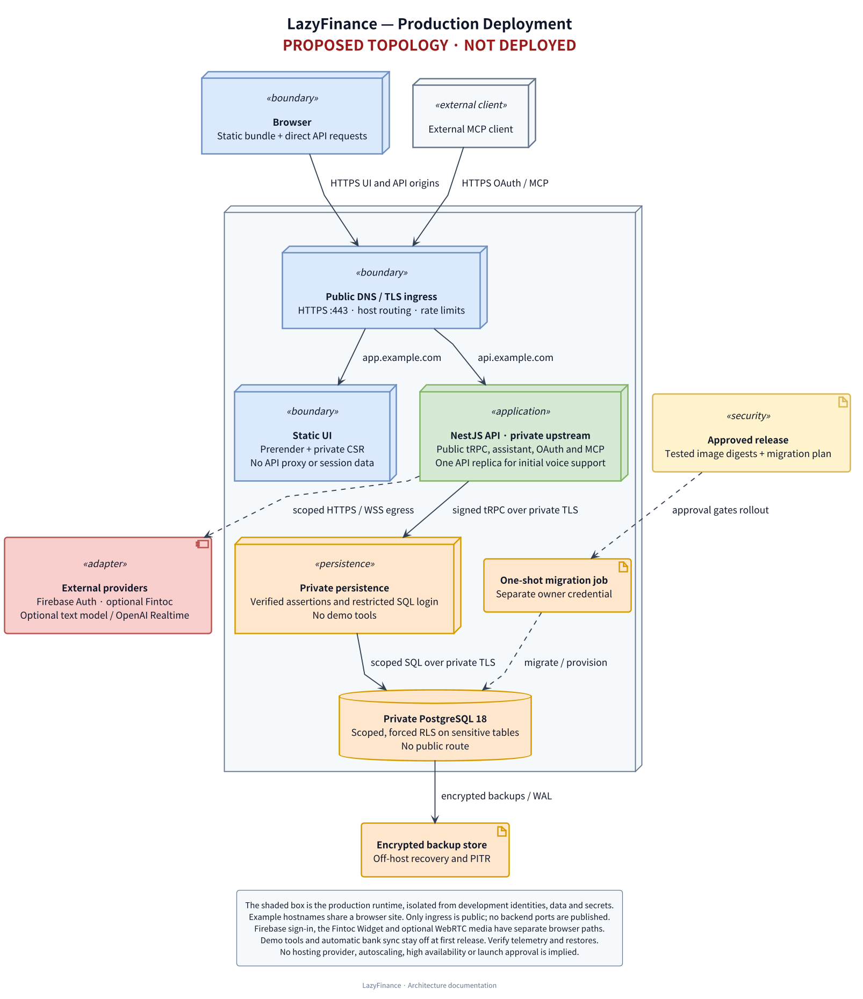

# Production deployment proposal

**Status: design only.** No production environment, hosting provider, region or
launch scope is approved by this document. The
[Stage C development deployment](technical-manual.md#development-deployment)
runs on its own Compose stack. The [Stage C gate](../planning/stage-c/closure.md)
accepted that increment for development, not release. This proposal keeps the
current application boundaries and describes the controls needed around them.

[Full-size diagram](../diagrams/production.png) ·
[Editable PlantUML](../diagrams/sources/production.puml)

## Public edge and client traffic

- Serve the static UI at `https://app.example.com` and the API at
  `https://api.example.com`. These are placeholders for distinct origins on the
  same browser site so MCP's interaction cookies work. Build the UI against the
  actual API origin; changing ingress or CORS cannot change a compiled bundle.
  Set `CORS_ORIGINS`, the OAuth issuer and its UI origin to the approved hosts.
- Only the HTTPS ingress accepts internet traffic. It routes by host to static
  hosting or to the API; the UI server is not an API proxy. Keep fingerprinted
  assets cacheable, HTML non-personalized and revalidated, and authenticated/API
  responses out of shared caches. Verify that the edge does not buffer the
  assistant or MCP streams, truncate their allowed time windows, or replay
  mutations on transport failure.
- Set request limits and abuse alerts at the edge, particularly for OAuth
  registration and authorization. Restrict access to the upstream API and only
  trust forwarded headers from the TLS proxy after it strips/replaces incoming
  values. See [MCP operations](mcp-authorization.md#configuration-and-operations).
- Use a separate Firebase project for production sign-in and server verification.
  The API makes scoped outbound calls for configured providers; Firebase sign-in,
  the Fintoc Widget and optional WebRTC media have their own client-side paths.
  If voice is enabled, the server still owns setup, sideband controls and financial
  tools. Media flows between the browser and OpenAI, not through ingress or
  persistence. See the [voice transport](assistant-live-voice.md#transport-and-authority).

## Private services and data

| Boundary | Proposed production control |
| --- | --- |
| API → persistence | Private route from the API only, with TLS and the existing signed tRPC context. Signatures authenticate the context; they do not encrypt transport. The API cannot reach PostgreSQL. |
| Persistence → PostgreSQL | Private PostgreSQL 18 with TLS and peer verification. The runtime login cannot own tables or bypass RLS. Verify that the chosen service supports the migrations, scoped grants, bootstrap roles and forced RLS before selecting it. |
| Privileged DDL | Use the matched persistence image as a one-shot migration/provisioning job before application rollout. Only the job gets the owner credential; neither runtime container gets it. Never include demo-role provisioning, reset or seed jobs in the production rollout. |
| Secrets | Separate owner and runtime database credentials, the API signing key, Firebase Admin credentials, and optional OAuth, bank and model keys. Persistence receives the private-RPC verification key, not the signing key. Use scoped secret delivery and rehearse rotation and recovery of the keys needed to read stored encrypted data. |
| Backups | Set recovery point and recovery time objectives, then use encrypted off-host backups and point-in-time recovery. Test restores to an isolated environment, including compatible migrations, runtime grants and access to required decryption keys. A Compose volume is not a backup. |

## Initial release and verification

1. **Choose a narrow scope.** Use Firebase. Disable mock login, demo tools and
   automatic bank synchronization. Add optional banking, hosted model and voice
   integrations only after live compatibility, consent, retention, spend and
   provider-entitlement checks. The diagram shows one API replica: if voice is
   enabled, process-local admission and hangup recovery require it. Multiple voice
   replicas need durable coordination; the proposal does not claim high availability.
2. **Promote exact artifacts.** Build and test a matched set of candidate UI, API
   and persistence images. Pin their digests and the schema revision, review the
   dependency and image audit, and require approval before the migration job and
   rollout. The development workflow's `main` push and `latest` tags are not this
   release path. Plan rollback or forward recovery for schema changes before applying
   them; reverting an image alone may leave it incompatible with the database.
3. **Exercise the deployed paths.** Verify public TLS/origins and private network
   isolation, then authenticated reads and writes, owner boundaries, streaming and
   only the provider/client combinations in scope. Measure representative peak
   traffic on the chosen profile. The [Stage C benchmarks](../planning/stage-c/performance-testing.md)
   passed a larger resource profile but did not pass all representative reads on
   the smaller profile; they do not size this deployment.
4. **Prepare operations.** Monitor request latency/errors, stream failures, database
   saturation, provider backoff/spend and backup freshness. Keep bearer tokens,
   provider credentials, financial payloads and voice media out of telemetry. Test
   alerts, failed rollouts and restores; public liveness alone does not prove
   readiness or recovery. Review the
   [open release follow-ups](../planning/stage-c/closure.md#open-release-follow-ups)
   and [product release checklist](../planning/product-definition-of-done.md).

Hosting, capacity, recovery objectives and release ownership remain decisions for
the release review. This design is not authorization to deploy.
